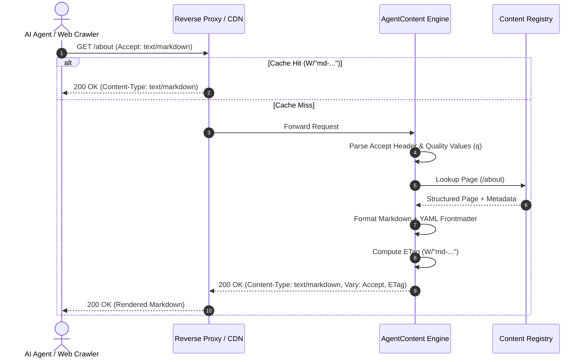

<div align="center">

# 🤖 AgentContent

### **Make every website readable by AI agents.**

*Developer infrastructure for HTTP Markdown content negotiation, structured content registry, HTML-to-Markdown conversion, and deterministic `llms.txt` discovery.*

---

[](https://github.com/iitdeveloper-git/agent-content/actions/workflows/ci.yml)
[](https://www.npmjs.com/package/@iitdeveloper/agent-content)
[](https://opensource.org/licenses/Apache-2.0)
[](https://www.typescriptlang.org/)
[](https://nodejs.org/)
[](https://pnpm.io/)
[](CONTRIBUTING.md)

[**Quickstart**](#-quickstart-in-3-minutes) • [**Key Features**](#-key-features) • [**Architecture**](#-architecture--how-it-works) • [**Packages**](#-npm-packages) • [**Universal Compatibility**](#-universal-website-compatibility) • [**Documentation**](#-deep-dive-documentation)

---

</div>

<br/>

## 🌟 Why AgentContent?

Modern websites are crafted for human eyes: loaded with megabytes of navigation menus, CSS stylesheets, JavaScript bundles, tracking pixels, cookie consent modals, and dynamic widgets.

When an AI agent (such as **Claude**, **GPT-4**, **Cursor**, **Perplexity**, or an autonomous research agent) queries your website, it often consumes hundreds of thousands of tokens parsing raw HTML noise—wasting bandwidth, increasing latency, driving up inference costs, and increasing hallucination rates.

**AgentContent fixes this with zero disruption to your human visitors:**

| Feature | 🛑 Without AgentContent | ⚡️ With AgentContent |
| :--- | :--- | :--- |
| **Human Browser Visit** | Standard HTML / CSS / JS | Standard HTML / CSS / JS (Unchanged!) |
| **AI Agent Request (`Accept: text/markdown`)** | Raw HTML full of navigation, scripts, and clutter | Clean structured Markdown with YAML frontmatter |
| **Context Window Efficiency** | Large context windows wasted on UI boilerplate | High-signal, token-efficient content representation |
| **AI Discovery** | Scrapes sitemaps or guessing links | Automatic [`/llms.txt`](https://llmstxt.org) & [`/llms-full.txt`](https://llmstxt.org) |
| **Cache Safety** | High risk of CDN serving wrong format | Dedicated ETags (`W/"md-..."`) & standard `Vary: Accept` |
| **CMS Migration** | Requires complete CMS overhaul | **Zero CMS migration** — Works with Next.js, Node, Static, PHP |

> [!NOTE]
> *Delivering Markdown optimizes agent readability and token efficiency. It does not guarantee AI search engine rankings or inclusion in LLM-generated answers.*

---

## ⚡️ Key Features

```
  ┌────────────────────────────────────────────────────────────────────────┐
  │                           AGENTCONTENT ENGINE                          │
  ├──────────────────┬──────────────────┬─────────────────┬────────────────┤
  │ 📡 Content       │ 🧹 Smart HTML-   │ 💎 Structured   │ 🧭 llms.txt    │
  │    Negotiation   │    to-Markdown   │    Content API  │    Discovery   │
  ├──────────────────┼──────────────────┼─────────────────┼────────────────┤
  │ 🛡️ Security &    │ 🏎️ CDN & Cache   │ 💻 Static CLI   │ 🌐 Universal   │
  │    SSRF Defense  │    Segregation   │    Builder      │    Adapters    │
  └──────────────────┴──────────────────┴─────────────────┴────────────────┘
```

- 📡 **Deterministic Content Negotiation:** Compliant with RFC 9110 quality values (`q`), supporting `Accept: text/markdown`, `/page.md`, and `?format=md`. Safe browser wildcard fallback (`*/*;q=0.8` continues receiving HTML).
- 🧹 **Intelligent Markdown Engine:** Powered by Cheerio and Turndown with GitHub Flavored Markdown (GFM) tables, language-fenced code blocks (```` ```typescript ````), and automated clutter elimination (`<script>`, `<style>`, `<nav>`, `<footer>`, cookie banners, modals).
- 💎 **First-Class Structured Content API:** Prefer pure structured data (`defineAgentContent`) for zero-loss Markdown generation, with HTML conversion as a fallback.
- 🧭 **RFC-Compliant Discovery (`llms.txt`):** Automatically generates standard `/llms.txt` and aggregated `/llms-full.txt` discovery indices for web agents.
- 🏎️ **CDN & Reverse-Proxy Integrity:** Emits representation-specific ETags (`W/"md-..."`), standard `Vary: Accept`, and conditional GET handling (`HTTP 304 Not Modified`) so CDNs never confuse HTML and Markdown responses.
- 🛡️ **Enterprise Security by Default:** Built-in path traversal guards, SSRF protection against private IPv4/IPv6, loopbacks, and cloud metadata (`169.254.169.254`), request/response size limits, and draft route isolation.
- 🌐 **Universal Website Compatibility:** Native adapters for Next.js App Router, Express, Web Fetch API, vanilla HTML/CSS/JS, PHP, Nginx, Apache, Netlify, and Vercel.

---

## 📦 npm Packages

Install only the package you need for your framework. Adapters re-export the entire core engine for a single-command setup:

| Package | Version | Description | Install Command |
| :--- | :--- | :--- | :--- |
| [`@iitdeveloper/agent-content`](packages/core) | `v0.1.0` | **Framework-independent core engine**: negotiation, conversion, discovery, caching, and security. | `npm install @iitdeveloper/agent-content` |
| [`@iitdeveloper/agent-content-nextjs`](packages/nextjs) | `v0.1.0` | **Next.js App Router adapter**: Route Handlers (`GET`, `HEAD`) and discovery routes. Re-exports core. | `npm install @iitdeveloper/agent-content-nextjs` |
| [`@iitdeveloper/agent-content-node`](packages/node) | `v0.1.0` | **Node.js & Express adapter**: Middleware and Web Fetch API handlers. Re-exports core. | `npm install @iitdeveloper/agent-content-node` |
| [`@iitdeveloper/agent-content-cli`](packages/cli) | `v0.1.0` | **Command Line Interface**: Scaffolding, validation, and static HTML-to-Markdown builder. | `npx @iitdeveloper/agent-content-cli` |

---

## 🚀 Quickstart in 3 Minutes

### Option A: Next.js App Router (Next.js 14, 15 & 16)

#### 1. Install adapter
```bash
npm install @iitdeveloper/agent-content-nextjs
```

#### 2. Define your content (`agent-content.config.ts`)
```ts
import { defineAgentContent } from '@iitdeveloper/agent-content-nextjs';

export const agentContent = defineAgentContent({
  site: {
    name: 'Acme Developer Hub',
    url: 'https://docs.acme.com',
    description: 'Cloud platform and developer API documentation.',
  },
  pages: [
    {
      url: '/quickstart',
      title: 'Quickstart Guide',
      description: 'Get started in 5 minutes.',
      content: '# Quickstart Guide\n\nRun `npm install @acme/sdk` to begin building.',
      category: 'Guides',
      status: 'published',
      updatedAt: '2026-11-01',
    },
  ],
});
```

#### 3. Create Route Handlers
```ts
// app/api/agent-content/[...slug]/route.ts
import { createAgentContentHandler } from '@iitdeveloper/agent-content-nextjs';
import { agentContent } from '@/agent-content.config';

export const { GET, HEAD } = createAgentContentHandler({
  content: agentContent,
});
```

```ts
// app/llms.txt/route.ts
import { createLlmsTxtHandler } from '@iitdeveloper/agent-content-nextjs';
import { agentContent } from '@/agent-content.config';

export const { GET, HEAD } = createLlmsTxtHandler(agentContent);
```

#### 4. Clean URL Routing (Optional)

In Next.js 16 (`proxy.ts`) or Next.js 14/15 (`middleware.ts`):

```ts
import { NextResponse, type NextRequest } from 'next/server';
import { shouldRewriteToMarkdown } from '@iitdeveloper/agent-content-nextjs/proxy';

export default function proxy(request: NextRequest) {
  const decision = shouldRewriteToMarkdown(request);

  if (decision.rewrite) {
    const url = request.nextUrl.clone();
    url.pathname = `/api/agent-content${request.nextUrl.pathname}`;
    return NextResponse.rewrite(url);
  }

  return NextResponse.next();
}
```

> Import from the `/proxy` entry point so Next.js 14/15 Edge `middleware.ts` stays dependency-free. Next.js overwrites `Vary` on its own HTML responses, so if a CDN caches the same URL for both formats, key the cache on `Accept` or use `/page.md` URLs — see [Next.js guide](docs/NEXTJS_INTEGRATION.md#cdn-caching-caveat-vary-accept-on-nextjs-html-pages).

---

### Option B: Node.js & Express

```bash
npm install @iitdeveloper/agent-content-node
```

```ts
import express from 'express';
import { defineAgentContent, createNodeMiddleware } from '@iitdeveloper/agent-content-node';

const app = express();

const content = defineAgentContent({
  site: { name: 'Acme SaaS', url: 'https://example.com' },
  pages: [
    {
      url: '/pricing',
      title: 'Pricing Plans',
      content: '# Pricing\n\n- Free: $0/mo\n- Pro: $29/mo',
      status: 'published',
    },
  ],
});

// Intercepts Accept: text/markdown, /pricing.md, ?format=md, and /llms.txt
app.use(createNodeMiddleware({ content }));

// Human web visitors continue receiving normal HTML!
app.get('*', (req, res) => {
  res.send('<!DOCTYPE html><html><body><h1>Standard Web Page</h1></body></html>');
});

app.listen(3000, () => console.log('Server running on port 3000'));
```

---

### Option C: Static Website CLI (Vanilla HTML, Astro, Hugo, Jekyll, Vite)

Transform any pre-built static HTML website folder into agent-ready Markdown in one command:

```bash
npx @iitdeveloper/agent-content-cli build --dir ./dist --base-url https://example.com
```

```text
  AgentContent Build Summary
  ══════════════════════════════════════════════════
    HTML Pages Discovered : 18
    Markdown Pages Built  : 18
    HTML Input Size       : 164.2 KB
    Markdown Output Size  : 32.1 KB
    Payload Reduction     : Significant clutter & byte reduction ⚡️
    Build Duration        : 45ms
  ──────────────────────────────────────────────────
    ✓ llms.txt generated     : dist/llms.txt
    ✓ llms-full.txt generated: dist/llms-full.txt
  ══════════════════════════════════════════════════
```

*Note: Generating server rewrite rules (`--generate-rules`) is opt-in to protect your existing configuration.*

---

### Option D: PHP & WordPress

Drop our standalone zero-dependency [`AgentContent.php`](examples/php/AgentContent.php) into your project:

```php
<?php
require_once __DIR__ . '/AgentContent.php';

$agent = new AgentContent(__DIR__ . '/markdown');
$agent->handle(); // Intercepts Accept: text/markdown and exits

// Standard WordPress / PHP HTML rendering continues:
get_header();
```

---

## 🏛️ Architecture & How It Works



---

## 🌐 Universal Website Compatibility

| Environment | Supported | Integration Mechanism | Documentation |
| :--- | :---: | :--- | :--- |
| **Next.js 15 & 16** | :white_check_mark: Verified | App Router Route Handlers (`GET`, `HEAD`) + `shouldRewriteToMarkdown` | [Next.js Guide](docs/NEXTJS_INTEGRATION.md) |
| **Next.js 14** | :white_check_mark: Supported | App Router Route Handlers (`GET`, `HEAD`) | [Next.js Guide](docs/NEXTJS_INTEGRATION.md) |
| **Express / Connect** | :white_check_mark: Verified | `createNodeMiddleware({ content })` | [Node.js Guide](docs/NODE_INTEGRATION.md) |
| **Fetch API runtimes (Hono, Bun, Deno)** | :large_orange_diamond: Node-compatible runtimes; not yet tested in CI | Web Fetch API `createFetchHandler({ content })` | [Node.js Guide](docs/NODE_INTEGRATION.md) |
| **Vanilla HTML / CSS / JS** | :white_check_mark: Verified | `agent-content-cli build` + `<link>` discovery | [Vanilla HTML Guide](docs/integrations/VANILLA_HTML.md) |
| **Netlify Static Hosting** | :white_check_mark: Configured | `_headers` + Netlify Edge Functions | [Netlify Guide](docs/integrations/NETLIFY.md) |
| **Vercel Static Hosting** | :white_check_mark: Configured | `vercel.json` header & query rewrites | [Vercel Guide](docs/integrations/VERCEL.md) |
| **GitHub Pages** | :white_check_mark: Configured | Pre-built `.md` URLs & GitHub Actions CI | [GitHub Pages Guide](docs/integrations/GITHUB_PAGES.md) |
| **Nginx Web Server** | :white_check_mark: Configured | Native `$http_accept` rewrite blocks | [Nginx Guide](docs/integrations/NGINX.md) |
| **Apache HTTP Server** | :white_check_mark: Configured | `mod_rewrite` & `mod_headers` `.htaccess` | [Apache Guide](docs/integrations/APACHE.md) |
| **PHP** | :white_check_mark: Available | Zero-dependency `AgentContent.php` helper | [PHP Guide](docs/integrations/PHP.md) |
| **WordPress** | 🔄 Planned | Drop-in PHP helper or static export (Dedicated plugin planned) | [PHP Guide](docs/integrations/PHP.md) |

---

## 🔒 Security Model

AgentContent treats security as a fundamental requirement:

- 🛡️ **Strict Path Traversal Defense:** Sanitizes all input paths, rejects null bytes (`\0`, `%00`), and blocks directory traversal attempts (`..`, `%2e%2e`).
- 🛡️ **SSRF Defense:** When remote fetching is enabled, strictly blocks requests to loopback addresses (`127.0.0.0/8`, `::1`, `localhost.`), private subnets (`10.0.0.0/8`, `172.16.0.0/12`, `192.168.0.0/16`), carrier-grade NAT (`100.64.0.0/10`), cloud metadata (`169.254.169.254`, `metadata.google.internal`), and resolves DNS to detect hostnames resolving to private IPs (e.g. `127.0.0.1.nip.io`).
- 🛡️ **Draft Isolation:** Unpublished pages (`status: 'draft'`) are never exposed or indexed in public discovery files.
- 🛡️ **Resource Exhaustion Defense:** Iterative DOM depth capping prevents stack overflow, and oversized table truncation prevents CPU event-loop blocking. Maximum 5MB input and 10MB output guards prevent memory exhaustion.
- 🛡️ **Cache Leakage Defense:** Automatic private caching for fallback-rendered or credentialed requests.

For more details, read our [Security Architecture & Threat Model](docs/SECURITY.md) and [Security Policy](SECURITY.md).

---

## 📖 Deep-Dive Documentation

- 📐 [**System Architecture**](docs/ARCHITECTURE.md) — Topology, delivery pipelines, and CDN mechanics.
- ⚙️ [**Configuration Reference**](docs/CONFIGURATION.md) — Complete options for sites, pages, caching, and security.
- 📡 [**HTTP Content Negotiation Specification**](docs/MARKDOWN_NEGOTIATION.md) — RFC 9110 rules, precedence, and headers.
- 🧭 [**llms.txt & llms-full.txt Guide**](docs/LLMS_TXT.md) — Standard discovery formats for LLMs.
- 🏎️ [**HTTP Caching & CDN Integration**](docs/CACHING.md) — ETags, 304 Not Modified, and Vary headers.
- 🛡️ [**Security Architecture**](docs/SECURITY.md) — Threat model and defensive safeguards.
- 🗺️ [**Product Roadmap**](docs/ROADMAP.md) — Upcoming releases (Nuxt, Astro, SvelteKit, WordPress plugin).

---

## 🧪 Testing & Verification

The test suite runs with [Vitest](https://vitest.dev/) across Node.js 18, 20, and 22:

```bash
# Clone the repository
git clone https://github.com/iitdeveloper-git/agent-content.git
cd agent-content

# Install monorepo dependencies
pnpm install

# Build all packages
pnpm build

# Run 104 unit, integration, and security tests
pnpm test

# Run test coverage
pnpm test:coverage

# Run strict TypeScript checks
pnpm typecheck

# Run linter
pnpm lint
```

---

## 🤝 Contributing

We welcome contributions from the open-source community! Please review our [Contributing Guide](CONTRIBUTING.md) and [Code of Conduct](CODE_OF_CONDUCT.md).

1. Fork the repository.
2. Create your feature branch (`git checkout -b feat/my-new-feature`).
3. Commit your changes (`git commit -m 'feat: add support for ...'`).
4. Push to the branch (`git push origin feat/my-new-feature`).
5. Open a Pull Request using our [PR Template](.github/PULL_REQUEST_TEMPLATE.md).

---

## 🏢 Independence from Growixa

AgentContent is an open-source developer infrastructure project built by **IITDEVELOPER**. It is completely decoupled from Growixa. There are zero Growixa APIs, accounts, billing, tenant logic, or commercial requirements. Any platform (including Growixa) may consume AgentContent strictly through its public open-source interfaces.

---

## 📜 License

Distributed under the **Apache License 2.0**. See [`LICENSE`](LICENSE) for more information.

Copyright © 2026 **IITDEVELOPER**. All rights reserved.
