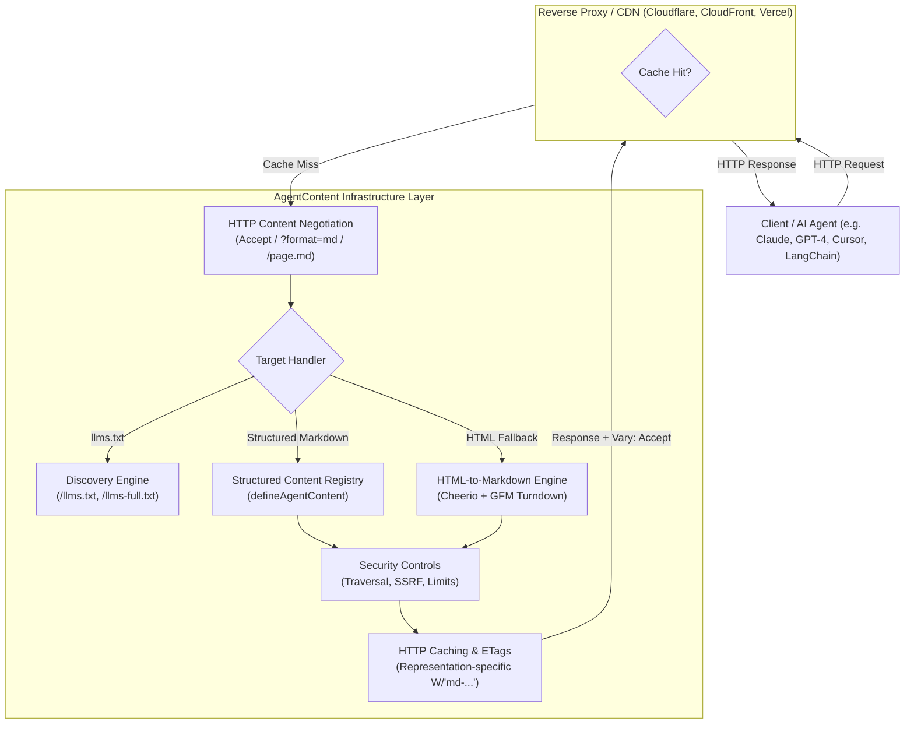

# AgentContent Architecture Specification

**Organization:** IITDEVELOPER  
**License:** Apache-2.0  
**Package Scope:** `@iitdeveloper/*`

---

## 1. System Overview

AgentContent is an open-source developer infrastructure suite designed to bridge modern websites and AI agents. It ensures that any website can expose clean, semantically rich Markdown, structured metadata, and discovery endpoints (`llms.txt`) with deterministic performance and enterprise-grade security.



---

## 2. Core Package Topology

```
agent-content/
├── packages/
│   ├── core/           # @iitdeveloper/agent-content
│   │                   # Pure framework-agnostic TypeScript engine.
│   │                   # Zero framework dependencies.
│   │
│   ├── nextjs/         # @iitdeveloper/agent-content-nextjs
│   │                   # Next.js 14, 15 & 16 App Router route handlers and proxy helpers.
│   │
│   ├── node/           # @iitdeveloper/agent-content-node
│   │                   # Express, Connect, and Web Fetch API adapters.
│   │
│   └── cli/            # @iitdeveloper/agent-content-cli
│                       # Project initialization, validation, and static generation.
```

### Dependency Inversion & Isolation
- `@iitdeveloper/agent-content` (Core) has **zero** runtime dependencies on Next.js, React, Express, or Node-specific HTTP servers. It uses Web Standard primitives (`Request`, `Response`, `Headers`, `URL`, crypto).
- Framework adapters (`@iitdeveloper/agent-content-nextjs`, `@iitdeveloper/agent-content-node`) wrap `@iitdeveloper/agent-content` functions and re-export core capabilities without introducing foreign domain logic.
- AgentContent is 100% decoupled from Growixa. Growixa may consume AgentContent, but AgentContent contains zero proprietary commercial dependencies.

---

## 3. The Delivery Pipeline

### 3.1 Content Negotiation Flow
The engine evaluates requests in a strictly deterministic sequence:
1. **Explicit Query Parameter (`?format=md`)**:
   - Highest priority.
   - Sets `shouldVaryAccept = false` because the URI itself specifies the format.
2. **Explicit Path Extension (`/path.md`)**:
   - Strips `.md` to obtain the canonical route `/path`.
   - Sets `shouldVaryAccept = false`.
3. **HTTP Accept Header (`Accept: text/markdown`)**:
   - Parses RFC 9110 quality values (`q=0` to `q=1`).
   - If `text/markdown` quality exceeds HTML quality and is non-zero, Markdown is chosen.
   - Sets `shouldVaryAccept = true` (emits `Vary: Accept`).
4. **Default Fallback**:
   - Standard browser visits receiving `text/html,*/*;q=0.8` fall through to HTML.

### 3.2 Structured Content Preference
Structured content is the **first-class source** of truth:
- When a page is defined in the `ContentRegistry`, AgentContent directly formats the Markdown and YAML frontmatter without lossy HTML roundtrips.
- HTML-to-Markdown conversion is used strictly as a **fallback** when only raw HTML is available.

---

## 4. Cache & CDN Coexistence

A primary risk in content negotiation is **cache collision**: an intermediate proxy caching Markdown for `/about` and subsequently serving it to human browsers, or vice versa.

AgentContent prevents cache collisions through three mechanisms:
1. **Dynamic `Vary: Accept`**: Emitted whenever content negotiation was influenced by the `Accept` header.
2. **Representation-Specific ETags**: Markdown ETags are prefixed with `W/"md-..."`, ensuring they never match HTML ETags.
3. **Immutable URI representations**: `/page.md` and `?format=md` do not emit `Vary: Accept`, enabling CDNs to cache them under unique URI keys.

