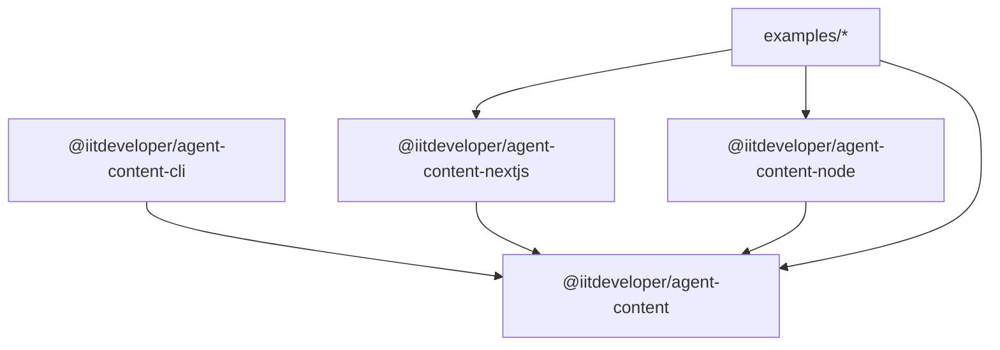

# AgentContent — Implementation Plan

**Organization:** IITDEVELOPER  
**Repository:** `https://github.com/iitdeveloper-git/agent-content`  
**License:** Apache-2.0  
**Scope:** `@iitdeveloper/*`

---

## 1. Architectural Blueprint & Package Topology

AgentContent is organized as a pnpm monorepo with strict package boundaries:

```
agent-content/
├── packages/
│   ├── core/           # @iitdeveloper/agent-content (Zero external framework dependencies)
│   ├── nextjs/         # @iitdeveloper/agent-content-nextjs (Next.js App Router route handlers & helpers)
│   ├── node/           # @iitdeveloper/agent-content-node (Express, Connect, vanilla Node HTTP, Web Fetch API)
│   └── cli/            # @iitdeveloper/agent-content-cli (CLI tools for init, validation, and static generation)
├── examples/
│   ├── basic-node/           # Express/Node server demonstration
│   ├── nextjs-app-router/    # Next.js 14/15/16 App Router demonstration
│   └── structured-content/   # CMS / Structured data pipeline demonstration
├── tests/
│   └── integration/    # Cross-package end-to-end integration tests
└── docs/               # Architecture, Security, Integration Guides
```

### Dependency Inversion & Isolation


- `@iitdeveloper/agent-content` depends only on battle-tested, lightweight parsers (`cheerio`, `turndown` or equivalent, `yaml`, `zod`). It contains zero references to Node `http`, Next.js, or Express.
- `@iitdeveloper/agent-content-nextjs` depends on `@iitdeveloper/agent-content` and treats `next` as an optional peer dependency.
- `@iitdeveloper/agent-content-node` depends on `@iitdeveloper/agent-content` and treats Node HTTP / Express as peer/optional dependencies.
- `@iitdeveloper/agent-content-cli` depends on `@iitdeveloper/agent-content` and CLI utilities (`commander`, `glob`).

---

## 2. Phased Implementation Roadmap

### Phase 1: Monorepo Foundation & Tooling Setup
- [x] Audit repository and working environment.
- [ ] Configure `pnpm-workspace.yaml`, root `package.json`, `.npmrc`.
- [ ] Setup `tsconfig.base.json` and package-specific `tsconfig.json` files with strict type checking.
- [ ] Setup ESLint 9 (flat config) and Prettier for automated formatting.
- [ ] Setup Vitest with coverage reporting.
- [ ] Initialize `packages/core`, `packages/nextjs`, `packages/node`, `packages/cli`.

### Phase 2: Core Engine (`@iitdeveloper/agent-content`)
- [ ] **Content Negotiation Module (`src/negotiation/`)**:
  - Accept header parser with quality values (`q=0` check, wildcard handling).
  - Deterministic precedence: Query (`?format=md`) > Suffix (`/path.md`) > Header (`Accept: text/markdown`).
  - Vary header logic (only emit `Vary: Accept` when content varies based on Accept header).
- [ ] **Markdown Conversion Engine (`src/markdown/`)**:
  - `htmlToMarkdown(html, options)` using Cheerio and Turndown with GFM (GitHub Flavored Markdown) table support.
  - Safe element stripping: `<script>`, `<style>`, `<nav>`, `<footer>`, `<aside>`, `<iframe>`, cookie banners, hidden elements.
  - Heading normalization, link preservation with relative-to-absolute resolution option, image alt text preservation, fenced code blocks with language detection.
- [ ] **Structured Content & Registry (`src/content/`, `src/types/`)**:
  - `defineAgentContent(config)` schema with Zod validation.
  - In-memory `ContentRegistry` supporting page metadata (title, description, canonicalUrl, language, dates, authors, tags).
  - Clean separation: structured content served as Markdown directly; HTML conversion used only as fallback.
- [ ] **Metadata & Frontmatter (`src/metadata/`)**:
  - YAML frontmatter parser and serializer.
  - HTML `<meta>` / JSON-LD extractor.
- [ ] **llms.txt Generation (`src/discovery/`)**:
  - `generateLlmsTxt(config)` following the llmstxt.org specification.
  - `generateLlmsFullTxt(config)` with full aggregated Markdown.
  - Deterministic output, URL canonicalization, deduplication, section grouping.
- [ ] **HTTP Caching & Headers (`src/cache/`)**:
  - Content hashing and ETag generation with distinct representation prefixes (`W/"md-<hash>"`).
  - Conditional request validator (`If-None-Match`, `If-Modified-Since` -> 304 Not Modified).
  - Configurable `Cache-Control` header builders.
- [ ] **Security Controls (`src/security/`)**:
  - Path traversal defense (`..`, `%2e%2e`, null bytes, normalization).
  - SSRF protection validator (blocking IPv4 private, loopback, link-local, cloud metadata, IPv6 local/loopback).
  - HTML input sanitization and size limit guards.
  - Safe error sanitization.

### Phase 3: Framework Adapters

#### 3.1 Next.js App Router Adapter (`@iitdeveloper/agent-content-nextjs`)
- [ ] `createAgentContentHandler(options)`:
  - Generates standard Next.js App Router `GET` and `HEAD` Route Handlers.
  - Handles `/api/agent-content/[...slug]` or root-level catch-all route handlers.
  - Integrates conditional caching, ETag checking, HEAD responses without body, and `X-Content-Type-Options: nosniff`.
- [ ] Client / Server helpers for generating `llms.txt` and `llms-full.txt` App Router routes.

#### 3.2 Node.js Adapter (`@iitdeveloper/agent-content-node`)
- [ ] `createNodeMiddleware(options)`:
  - Standard `(req, res, next)` middleware for Express, Connect, and Polka.
  - Transparently intercepts `Accept: text/markdown`, `.md`, or `?format=md`.
  - Non-matching requests fall through to `next()`, ensuring standard human HTML browsing is untouched.
- [ ] `createFetchHandler(options)`:
  - Standard Web API `(request: Request) => Promise<Response>` for Hono, Cloudflare Workers, Fastify, Deno, Bun.

### Phase 4: CLI Utility (`@iitdeveloper/agent-content-cli`)
- [ ] `agent-content init`: Generates starter `agent-content.config.ts`.
- [ ] `agent-content validate`: Validates structured content files and configuration schemas.
- [ ] `agent-content generate-llms`: Statically writes `llms.txt` and `llms-full.txt` to output directory (e.g., `public/`).

### Phase 5: Verification, Integration Tests & Examples
- [ ] Unit tests for all modules in `@iitdeveloper/agent-content`.
- [ ] Integration tests in `tests/integration/`:
  - Browser vs Agent content negotiation.
  - `.md` suffix and `?format=md` routing.
  - HEAD requests returning headers only.
  - 304 conditional cache hits.
  - Next.js handler simulated requests.
  - Express middleware live HTTP requests.
- [ ] Security test suite:
  - Path traversal attack attempts.
  - SSRF private IP validation.
  - Malformed HTML and oversized payload rejection.
  - Draft / unpublished route isolation.
- [ ] Working runnable examples in `examples/`.

### Phase 6: Documentation, Open Source Governance & CI/CD
- [ ] Root documentation:
  - `README.md` (comprehensive, copy-paste quickstart, architecture, features).
  - `LICENSE` (Apache License 2.0).
  - `CONTRIBUTING.md`, `CODE_OF_CONDUCT.md`, `SECURITY.md`, `CHANGELOG.md`.
  - `AGENTS.md` (Operational instructions for AI agents working in this repository).
- [ ] Deep technical documentation in `docs/`:
  - `ARCHITECTURE.md`, `GETTING_STARTED.md`, `CONFIGURATION.md`, `NEXTJS_INTEGRATION.md`, `NODE_INTEGRATION.md`, `MARKDOWN_NEGOTIATION.md`, `LLMS_TXT.md`, `SECURITY.md`, `CACHING.md`, `ROADMAP.md`.
- [ ] GitHub Actions:
  - `.github/workflows/ci.yml`: Typecheck, lint, unit tests, integration tests across Node 18, 20, 22.
  - `.github/workflows/release.yml`: Automated build, changesets / npm publish configuration.
  - `.github/ISSUE_TEMPLATE/` and `PULL_REQUEST_TEMPLATE.md`.
- [ ] Final Engineering Report and Production Readiness Signoff.

---

## 3. Acceptance Criteria Checklist

- [ ] All packages compile with TypeScript strict mode and zero type errors.
- [ ] Unit test coverage exceeds 90% across core modules.
- [ ] Integration tests verify real HTTP scenarios (GET, HEAD, 304, Vary, ETag).
- [ ] Browser requests receive unmodified HTML; agent requests receive clean Markdown.
- [ ] Zero dependency on Growixa or external proprietary services.
- [ ] Security tests pass for path traversal, SSRF, and private route leakage.

