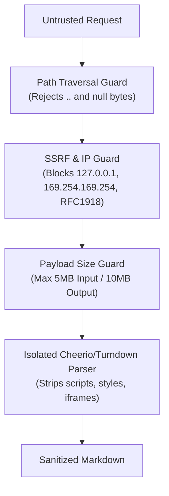

# Security Architecture & Threat Model

**Organization:** IITDEVELOPER  
**Security Contact:** security@iitdeveloper.com

---

## 1. Threat Modeling Overview

AgentContent processes incoming HTTP headers, URL paths, and (optionally) remote HTML documents to emit Markdown representations. Security is designed into every layer:

---

## 2. Path Traversal & File Access Protection

- **The Threat:** Attackers sending requests like `GET /../../etc/passwd.md` or encoded variations `%2e%2e%2f` to read sensitive server files.
- **AgentContent Defense:**
  - `validateAndNormalizePath()` strictly forbids null bytes (`\0`, `%00`).
  - Detects and rejects any directory traversal sequence (`..`, `\..`).
  - All page lookups resolve strictly against in-memory registries or explicit static build roots.
  - No arbitrary local filesystem file is ever read based on untrusted user input.

---

## 3. Server-Side Request Forgery (SSRF) Defense

When using fallback fetching or remote crawling:
- **Forbid Private IPv4:**
  - `127.0.0.0/8` (Loopback)
  - `10.0.0.0/8` (Private)
  - `172.16.0.0/12` (Private)
  - `192.168.0.0/16` (Private)
  - `169.254.0.0/16` (Link-local & Cloud Metadata `169.254.169.254`)
  - `100.64.0.0/10` (Carrier-grade NAT)
- **Forbid Private IPv6:**
  - `::1` (Loopback)
  - `fe80::/10` (Link-local)
  - `fc00::/7` (Unique local)
  - IPv4-mapped IPv6 in dotted or hex notation (e.g. `::ffff:127.0.0.1` and `::ffff:7f00:1`).
- **Other special-use ranges:** `0.0.0.0/8`, `192.0.0.0/24`, `198.18.0.0/15`, multicast/broadcast, `fec0::/10`, NAT64 (`64:ff9b::/96`), 6to4 (`2002::/16`), `localhost.`, `*.localhost`, and cloud metadata hostnames (e.g. `metadata.google.internal`).
- **DNS pinning (anti-rebinding):** `safeFetchUrl` does not trust a separate pre-flight lookup. The socket's own `lookup` resolves the hostname **once**, every returned address is checked against the private/reserved ranges, and the connection is made to that validated address. A name that resolves to a public address during the pre-check but to a private one at connect time is refused (`SSRFError: … at connect time`). Resolver failures fail **closed**.
- **Redirect Re-Validation:** Outbound requests do not follow redirects blindly; every redirect destination is validated (hostname rules + DNS) before following, and each hop is pinned the same way.
- **Limits of this control:** The protection applies to `safeFetchUrl` (Node.js runtime, direct connections). It does not cover HTTP(S) proxies configured via environment variables, custom `fetch` implementations you inject in your own `fallbackHtml`, or other code paths that fetch URLs. If your `fallbackHtml` fetches user-influenced URLs, call `safeFetchUrl` (or enforce egress filtering at the network layer). `ssrfProtection: false` disables all of the above and is intended for tests only.
- **Timeouts & Size Caps:** Outbound HTTP requests timeout after 5000ms by default and stream abort if the response exceeds 5MB.

---

## 4. Route Isolation & Data Leakage Prevention

- Unpublished pages, draft articles, and internal staging routes are strictly isolated.
- If a route is marked `status: 'draft'`, public lookup functions return HTTP 404 (never 403 or descriptive existence leaks).
- Error messages returned to clients never contain internal stack traces, environment variables, or server directory paths.

---

## 5. Denial-of-Service & Parser Exhaustion

- HTML input size is capped at 5MB default (`maxInputSizeBytes`).
- A linear-time pre-parse scan rejects pathological markup **before** it reaches the parser: nesting deeper than `maxNestingDepth` (default 512) or more than `maxElements` opening tags (default 200,000) throws `MarkdownConversionError` immediately. Optional-end-tag elements (`
`, `<li>`, `<td>`, …) are not counted as nesting. After parsing, the DOM is additionally capped at depth 128 and tables at `maxTableRows` (default 500, with a visible truncation note).
- The static-site CLI isolates failures per file: a rejected page is skipped with a warning and the rest of the build continues.
- Parsing is powered by `cheerio` and `htmlparser2` with linear $O(n)$ complexity, avoiding ReDoS (Regular Expression Denial of Service).
- Scripts, styles, iframes, templates, and hidden elements are eliminated before Markdown conversion.

